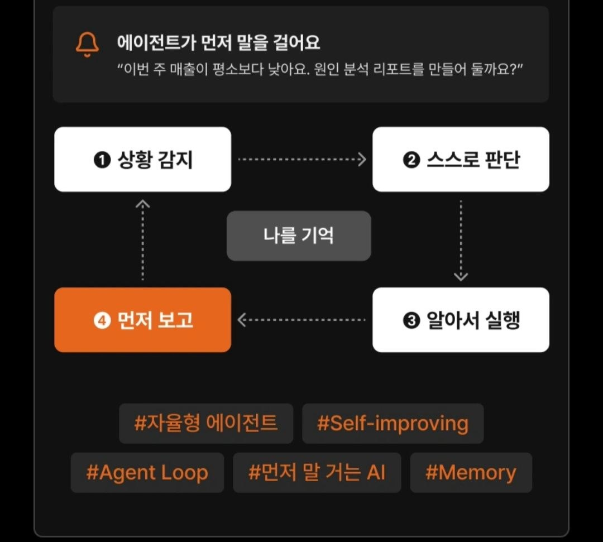
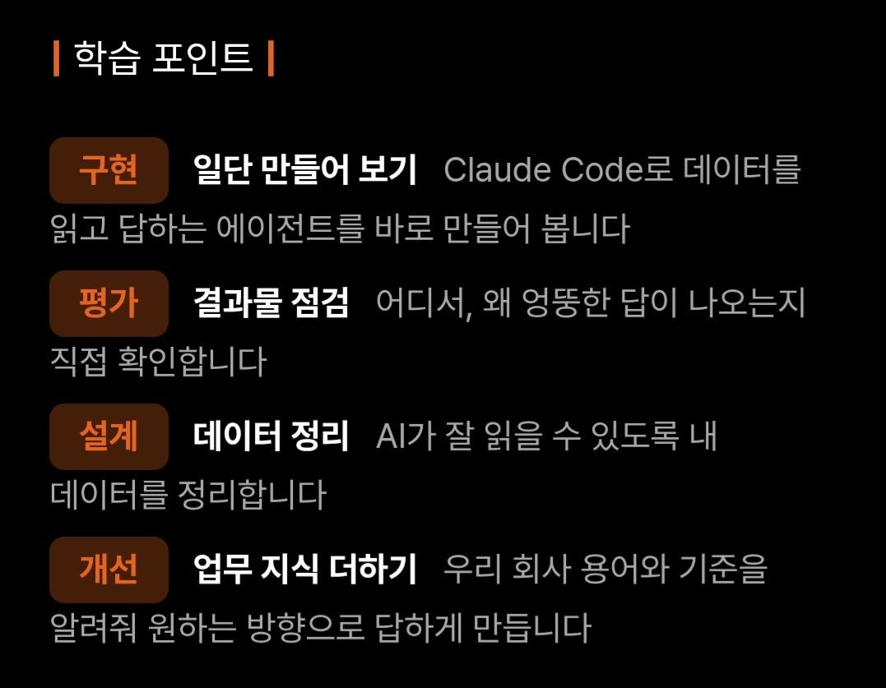
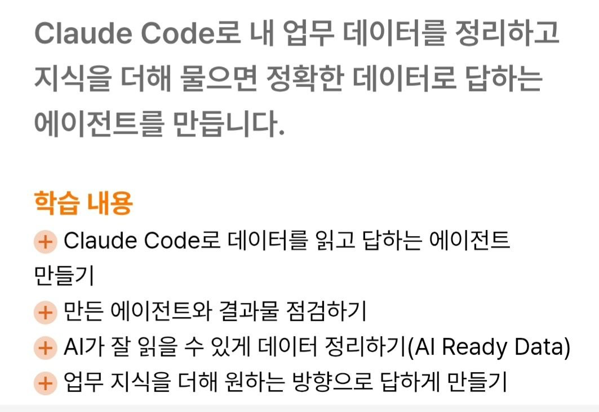
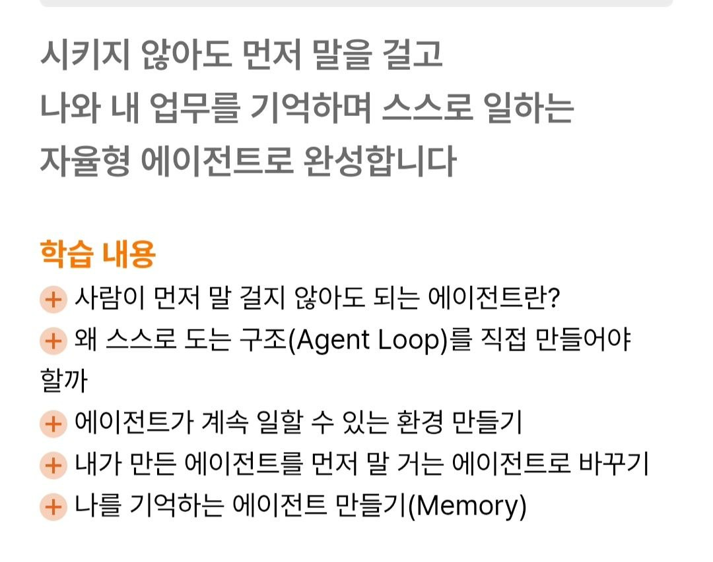
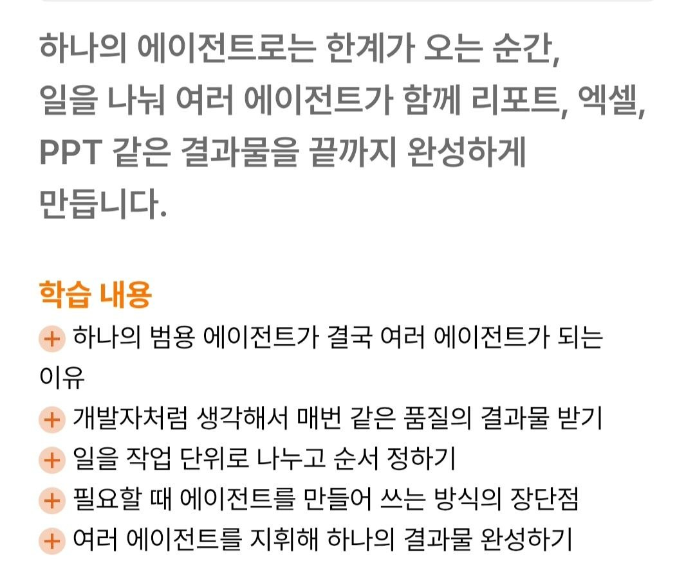

"이번 주 매출이 평소보다 낮아요. 원인 분석 리포트를 만들어 둘까요?"

아래 슬라이드는 이 말로 시작한다. 사람이 묻기 전에 에이전트가 먼저 말을 거는 장면이다. 이 글은 이 장면 뒤에 무엇이 있어야 하는지 정리한다. 자율형 에이전트가 무엇인지는 1차 문서와 논문으로 짚고, 어디에 쓰는지는 내가 운영하는 홈랩 K3s 클러스터에서 실제로 돌리는 감시 봇들을 예로 든다.

*그림 1. 자율형 에이전트 루프. 사용자가 보내 준 강의 소개 캡처이며 원 출처는 확인하지 못했다(아래 「근거의 한계」 참고).*

---

## 1. 먼저 용어: 워크플로와 에이전트는 다르다

"에이전트"라는 말은 넓게 쓰인다. Anthropic 의 「Building effective agents」(2024-12-19)는 이를 둘로 나눈다 ([Anthropic, 2024](https://www.anthropic.com/engineering/building-effective-agents)).

- **워크플로(workflow)**: "LLM 과 도구가 *미리 정해 둔 코드 경로*를 따라 조율되는 시스템"
- **에이전트(agent)**: "LLM 이 *자기 프로세스와 도구 사용을 스스로 동적으로 지휘*하는 시스템"

차이는 **다음에 무엇을 할지 누가 정하느냐**다. 코드가 정하면 워크플로이고, 모델이 정하면 에이전트다. 같은 글은 바로 이어서 경고한다. 가장 단순한 해법부터 시작하라고, 에이전트는 성능을 얻는 대신 **지연과 비용을 더 쓴다**고. 자율형 에이전트는 그 비용을 지불할 만한 일에만 쓴다.

에이전트를 이루는 기본 블록도 같은 글에 있다. 검색(retrieval)·도구(tools)·메모리(memory)를 붙인 **"augmented LLM"** 이다. 그림 1의 루프는 이 블록을 시간 축 위에 돌린 모양이다.

---

## 2. 그림 1의 루프를 한 칸씩

| 단계 | 그림의 말 | 기술적으로는 | 근거 |
| --- | --- | --- | --- |
| ① | 상황 감지 | 스케줄·이벤트·지표 변화가 루프를 깨운다(사용자 입력이 아니라) | — |
| ② | 스스로 판단 | 관찰을 근거로 추론하고 다음 행동을 고른다 | ReAct |
| ③ | 알아서 실행 | 도구를 호출해 환경을 바꾸거나 정보를 더 모은다 | ReAct, Anthropic |
| ④ | 먼저 보고 | 결과와 다음 제안을 사람에게 *먼저* 보낸다 | — |
| 중심 | 나를 기억 | 이전 실행·사용자 선호·실패 교훈을 다음 루프에 넣는다 | Generative Agents, MemGPT, Reflexion |

### ②③ 판단과 실행이 번갈아 도는 구조 — ReAct

판단과 실행을 한 루프에 섞는 아이디어의 대표 논문은 **ReAct** 다 ([Yao et al., 2022, arXiv:2210.03629](https://arxiv.org/abs/2210.03629)). 초록의 문제의식은 이렇다. 그때까지 추론(chain-of-thought)과 행동(action plan 생성)은 *따로* 연구됐다. ReAct 는 둘을 **번갈아(interleaved)** 생성하게 한다. 생각하고, 도구를 부르고, 결과를 보고, 다시 생각한다. 오늘 대부분의 에이전트 런타임이 이 모양이다.

### 중심의 "나를 기억" — 메모리

루프가 매번 백지에서 시작하면 그건 자율형이 아니라 *반복 실행*이다. 두 논문이 메모리 설계의 출발점이다.

- **Generative Agents** ([Park et al., 2023, arXiv:2304.03442](https://arxiv.org/abs/2304.03442), UIST '23): 에이전트 25개를 샌드박스 마을에 풀어 놓고, 경험을 기록하는 메모리 스트림, 기록을 묶어 더 높은 수준의 생각으로 만드는 reflection, 하루를 짜는 planning 을 붙였다.
- **MemGPT** ([Packer et al., 2023, arXiv:2310.08560](https://arxiv.org/abs/2310.08560)): 컨텍스트 창이 유한하다는 문제를 운영체제의 가상 메모리처럼 풀었다. 여러 저장 계층 사이에서 정보를 들였다 뺐다(paging) 한다.

### 태그의 "Self-improving" — Reflexion

**Reflexion** ([Shinn et al., 2023, arXiv:2303.11366](https://arxiv.org/abs/2303.11366))은 가중치를 고치지 않는다. 대신 실패 피드백을 *말로* 되돌아보고, 그 반성문을 에피소드 메모리에 넣어 다음 시도에 쓴다. "스스로 나아진다"는 말의 가장 현실적인 구현이 이것이다. 모델이 바뀌는 게 아니라 **다음 루프에 들어가는 메모가 바뀐다.**

### ④ "먼저 말 걸기"가 바꾸는 것

사용자가 물어서 답하는 에이전트는 사람이 *문을 여는* 구조다. 먼저 말을 거는 에이전트는 문을 에이전트가 연다. 그러면 두 가지가 새로 필요해진다.

1. **깨우는 장치.** 크론·이벤트·웹훅·지표 경보 같은 트리거가 있어야 한다. 모델이 혼자 시간을 재지는 않는다.
2. **허락의 경계.** 먼저 말을 거는 것과 먼저 *행동*하는 것은 다르다. Anthropic 이 2026-10 에 공개한 Claude Duet 도 소개문에서 "대신 행동하기 전에는 확인을 받는다"를 원칙으로 내세웠다 ([Anthropic, Introducing Claude Duet](https://claude.com/resources/articles/claude-duet); 이 블로그의 [정리 글](/2026/10/27/claude-duet-proactive-agent-design/)). 그림 1 헤더의 말투도 같다. "만들어 둘까요?" 는 제안이지 실행 통보가 아니다.

---

## 3. 만드는 법 — 구현·평가·설계·개선

*그림 2. 같은 강의의 학습 포인트 슬라이드(사용자 제공 캡처, 원 출처 미확인).*

그림 2의 네 단계는 순서가 좋다. **만들기 전에 설계하라**가 아니라 **먼저 만들고, 틀리는 곳을 보고, 그다음에 데이터를 고쳐라**다. 단계마다 1차 문서를 붙이면 이렇다.

### 구현 — 일단 만들어 보기

Claude Code 는 터미널에서 파일을 읽고, 명령을 실행하고, 결과를 보고 다시 판단한다. 그러니 그 자체가 ReAct 형 루프다. 데이터 폴더 하나를 주고 "이 데이터로 답하라"고 시키는 것만으로 첫 에이전트가 된다. 반복할 동작은 훅(hooks)으로 고정할 수 있다. 특정 시점에 자동으로 실행되는 셸 명령이다 ([Claude Code docs — Hooks](https://code.claude.com/docs/en/hooks)).

### 평가 — 어디서, 왜 엉뚱한 답이 나오는가

Anthropic 의 「Demystifying evals for AI agents」(2026-01-09)가 이 단계를 가장 정확하게 짚는다 ([Anthropic, 2026](https://www.anthropic.com/engineering/demystifying-evals-for-ai-agents)). 핵심 구분은 **transcript 와 outcome** 이다.

- transcript: 에이전트가 *말하고 한 일*의 기록
- outcome: 실행이 끝난 뒤 **환경의 최종 상태**. 문서의 예를 빌리면 에이전트가 "예약했습니다"라고 *말한 것*이 아니라 DB 에 예약이 *실제로 있는가*.

에이전트를 평가할 때 가장 흔한 실수는 transcript 를 보고 통과시키는 것이다. 같은 글은 평가 없이 운영하는 팀을 "flying blind"라고 부른다.

### 설계 — AI 가 잘 읽게 데이터 정리

「Effective context engineering for AI agents」(2025-09-29)는 이 일을 프롬프트 엔지니어링의 다음 단계, **컨텍스트 엔지니어링**이라고 부른다 ([Anthropic, 2025](https://www.anthropic.com/engineering/effective-context-engineering-for-ai-agents)). 근거는 두 가지다. 토큰이 늘수록 회상 정확도가 떨어지는 **context rot** 이 있고, 컨텍스트는 한정된 **attention budget** 이다. 그러니 "데이터를 다 넣는다"가 아니라 "필요한 것만 찾기 쉽게 둔다"가 설계 목표가 된다. 강의 소개의 "AI Ready Data"가 이 뜻이다.

### 개선 — 우리 회사 용어와 기준 더하기

Claude Code 에서 업무 지식을 더하는 가장 직접적인 방법은 `CLAUDE.md` 메모리 파일이다. 세션이 시작될 때 자동으로 읽혀 지시와 맥락이 된다 ([Claude Code docs — Memory](https://code.claude.com/docs/en/memory)). "우리 팀에서 '정산'은 이 테이블을 말한다", "이 지표는 KST 기준이다" 같은 것을 여기에 적는다. 그림 1 가운데의 "나를 기억"이 가장 단순하게 구현된 형태다.

---

## 4. 실제 사용사례 — 내 클러스터에서 돌고 있는 루프들

아래는 내가 홈랩 K3s 클러스터와 텔레그램 봇으로 실제 운영하는 것들이다. 화려한 데모가 아니라, 돌려 보다가 깨진 자리와 고친 방법까지 같이 적는다. 내부 주소·비밀값은 뺐다.

### 사례 1. 정산 서비스 딥 헬스 모니터 — 감지와 판단을 나눈다

- **감지**: 공개 도메인으로 서비스 헬스를 주기적으로 찌른다.
- **판단**: 실패해도 바로 "다운"이라고 하지 않는다. 노드에 들어가 내부 경로로 한 번 더 확인한다. 안에서는 살아 있으면 *앱 장애가 아니라 터널 경로 문제*로 분류한다.
- **보고**: 분류한 결과를 텔레그램으로 먼저 보낸다.
- **교훈**: 처음에는 2차 확인이 없었다. 그래서 "DOWN" 알림 대부분이 사실 Cloudflare 터널 경로가 잠깐 멈춘 것이었다. 감지만 있고 판단이 없는 루프는 사람을 양치기 소년 앞에 세운다.

### 사례 2. CI 실패 감시 — 보고 단계가 조용히 죽는다

- 정산 리포의 CI 실패를 10분마다 확인해 텔레그램으로 보고하는 잡이다.
- **교훈**: 리포가 비공개로 바뀐 뒤 API 가 404 를 돌려줬다. 잡은 그걸 "실패 없음"으로 읽었다. 그렇게 **32일 동안 아무 알림도 없이 죽어 있었다.** 실패를 정상으로 읽는 fail-open 이었다. 고친 뒤에는 *감시기 자신이 고장 나면 그것부터 보고*하게 했다.
- 비슷한 사례가 하나 더 있다. 맥의 cron 은 키체인을 읽지 못한다. 그래서 cron 에서 돌던 알림 스크립트는 토큰을 못 얻어 전부 조용히 실패했다. LaunchAgent 로 옮겨서 해결했다.

### 사례 3. 컨텍스트 사용량 감시 훅 — 에이전트가 자기 상태를 먼저 말한다

- 대화가 길어져 컨텍스트가 70·80·90% 를 넘으면 봇이 스스로 텔레그램으로 알린다. 압축(compaction)이 일어날 때도 알린다.
- 훅으로 구현한 *자기 감시*다. context rot 을 사람이 눈치채기 전에 에이전트 쪽에서 신호를 준다.

### 사례 4. 보안 운영 에이전트 — 실행 권한은 좁게, 기록은 위조 불가능하게

- 침입 탐지(Falco)·알림(Alertmanager) 이벤트가 오면 에이전트가 조사하고 리포트를 쓴다.
- 판단 과정은 **해시 체인 감사 로그**로 남긴다. 나중에 "왜 그렇게 판단했나"를 재생할 수 있다.
- **교훈 두 개**:
  - 검증한다고 감사 로그를 쓰는 함수를 운영 파드 안에서 직접 불렀다. 운영 체인에 끼어든 기록 때문에 다음 기동 때 체인 끊김 경보가 울렸다.
  - 파드 안에서 감사 로그 전체를 메모리에 올려 분석하다 메모리 한도로 본체가 OOMKill 됐다.
  - 둘 다 에이전트가 아니라 *내가* 한 실수다. 자율형 시스템을 운영하는 사람도 같은 경계 안에 있어야 한다.

### 사례 5. 파일 기반 장기 메모리 — "나를 기억"의 실물

- 이 봇들은 대화가 끝나도 남는 메모리 파일 묶음을 쓴다. 한 파일에 사실 하나를 적고, 색인 파일을 매 세션 자동으로 읽는다.
- 내용은 "이 리포는 develop 이 main 보다 훨씬 앞서 있으니 통째로 승격하지 말 것" 같은 *실패에서 나온 규칙*이다. 일부러 Reflexion 을 구현한 것은 아니지만 하는 일은 같다. 실패를 말로 적어 다음 루프에 넣는다.

### 사례들에서 공통으로 나온 규칙

1. **백그라운드 작업은 "끝났을 때"만 알린다.** 멈춰 버린 작업은 영원히 보고하지 않는다. 그래서 타임아웃과 화면 해시 같은 별도 워치독이 필요했다.
2. **감시기의 침묵은 정상이 아니다.** 보고가 없을 때 "문제없음"인지 "감시기 고장"인지 구분할 신호를 따로 둔다.
3. **되돌릴 수 없는 행동은 사람이 확인한다.** 삭제·외부 발송·운영 배포는 에이전트가 *제안*까지만 한다.
4. **출력이 아니라 결과를 실측한다.** "게시했습니다"가 아니라 URL 이 200 을 주는지, 본문 문구가 실제로 보이는지 확인한다. 2절의 transcript/outcome 구분과 같은 이야기다.

---

## 5. 더 나아가면 — 하나에서 여럿으로

사용자가 같은 강의의 커리큘럼 캡처 세 장을 더 보내 줬다. 1부 「데이터로 답하는 에이전트」, 2부 「먼저 말 거는 자율형 에이전트」, 3부 「여러 에이전트가 결과물을 완성」 순서다. 이 글이 다룬 것은 1·2부다.

*그림 3~5. 강의 커리큘럼(사용자 제공 캡처, 원 출처 미확인).*

3부의 멀티 에이전트에 대해서는 Anthropic 이 자사 리서치 기능을 만든 경험을 공개했다 ([Anthropic, 2025-06-13](https://www.anthropic.com/engineering/multi-agent-research-system)). 정의부터 간결하다. 멀티 에이전트 시스템은 "도구를 루프로 쓰는 LLM(=에이전트) 여러 개가 함께 일하는 것"이다. 글이 밝힌 숫자는 *벤더의 내부 평가*라서 그렇게 라벨을 붙여 옮긴다.

- **벤더 주장(내부 평가, 외부 재현 불가)**: 리드 에이전트 1개와 서브에이전트들로 구성한 시스템이 단일 에이전트보다 내부 리서치 평가에서 90.2% 높았다.
- **벤더 주장(내부 데이터)**: 비용은 에이전트가 채팅보다 토큰을 약 4배, 멀티 에이전트가 약 15배 쓴다.
- 같은 글의 단서: 모든 에이전트가 같은 맥락을 공유해야 하거나 의존이 많은 일은 아직 맞지 않는다. 대부분의 코딩 작업처럼 병렬로 나눌 몫이 적은 일이 그렇다.

1절의 "단순한 것부터"가 여기서 다시 나온다. 에이전트 하나로 안 되는 게 확인된 다음에 나눈다.

---

## 근거의 한계

- **그림 1~5의 출처**: 사용자가 텔레그램으로 보내 준 강의 소개 캡처다. 강의명·제작사·저작자를 확인하지 못했다. 이 글은 슬라이드의 구조를 설명하는 데에만 인용했다. 저작권자의 요청이 있으면 내린다.
- **성능 수치**: 이 글에서 숫자는 5절의 Anthropic 내부 평가 수치뿐이다. 벤더 1차 자료이고 외부에서 재현할 수 없다. 자율형 에이전트와 사람 운영자를 같은 조건에서 비교한 중립 제3자 벤치마크는 찾지 못했다.
- **사용사례**: 4절은 개인 홈랩 한 곳의 운영 경험이다. 조직 규모나 업무 도메인이 다르면 그대로 옮겨지지 않는다. 그리고 효과를 측정한 수치가 아니라 사건 기록이다.
- **논문들**: ReAct·Reflexion·Generative Agents·MemGPT 는 연구 프로토타입이다. 상용 제품이 이 구조를 그대로 쓴다는 뜻은 아니다. 개념의 계보로만 인용했다.

---

## References

1. Anthropic. "Building effective agents." 2024-12-19. <https://www.anthropic.com/engineering/building-effective-agents>
2. Anthropic. "Effective context engineering for AI agents." 2025-09-29. <https://www.anthropic.com/engineering/effective-context-engineering-for-ai-agents>
3. Anthropic. "Demystifying evals for AI agents." 2026-01-09. <https://www.anthropic.com/engineering/demystifying-evals-for-ai-agents>
4. Anthropic. "How we built our multi-agent research system." 2025-06-13. <https://www.anthropic.com/engineering/multi-agent-research-system>
5. Anthropic. "Introducing Claude Duet." 2026-10. <https://claude.com/resources/articles/claude-duet>
6. Claude Code docs. "Manage Claude's memory." <https://code.claude.com/docs/en/memory>
7. Claude Code docs. "Hooks reference." <https://code.claude.com/docs/en/hooks>
8. Yao, S., Zhao, J., Yu, D., Du, N., Shafran, I., Narasimhan, K., Cao, Y. "ReAct: Synergizing Reasoning and Acting in Language Models." arXiv:2210.03629 (ICLR 2023). <https://arxiv.org/abs/2210.03629>
9. Shinn, N., Cassano, F., Berman, E., Gopinath, A., Narasimhan, K., Yao, S. "Reflexion: Language Agents with Verbal Reinforcement Learning." arXiv:2303.11366 (NeurIPS 2023). <https://arxiv.org/abs/2303.11366>
10. Park, J. S., O'Brien, J. C., Cai, C. J., Morris, M. R., Liang, P., Bernstein, M. S. "Generative Agents: Interactive Simulacra of Human Behavior." UIST '23, arXiv:2304.03442. <https://arxiv.org/abs/2304.03442>
11. Packer, C., Wooders, S., Lin, K., Fang, V., Patil, S. G., Stoica, I., Gonzalez, J. E. "MemGPT: Towards LLMs as Operating Systems." arXiv:2310.08560. <https://arxiv.org/abs/2310.08560>
