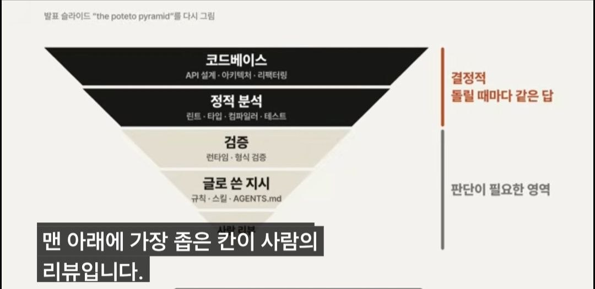

> 📺 원본 영상(한국어 정리): [한 달에 PR 1만 개, 그런데 쓰레기 코드는 없다 | Lauren Tan — Tech Bridge](https://youtu.be/nldpxmin-1M)
> 🎤 원 발표: [All Code Is Slop (Except Mine) — Lauren Tan, AI Engineer CODE 2026](https://www.youtube.com/watch?v=O_zcc6Xl12g) · [세션 페이지](https://ai.engineer/code/2026/talks/lauren-tan)

## 누가, 어디서 한 발표인가

발표자는 **Lauren Tan**이다. 온라인에서는 "Potato(poteto)"로 더 많이 알려져 있다. Meta·Netflix·Cursor를 거쳤고, React Core 팀에서 React Compiler 개발에 참여했다. 지금은 xAI(발표 당시 소속 표기는 SpaceXAI)에서 **Grok Bot** 클라이언트를 만든다. 이 글은 2026년 11월 11일 AI Engineer CODE 2026 기조 세션에서 한 발표를 정리한 것이다([세션 페이지](https://ai.engineer/code/2026/talks/lauren-tan), [발표 녹취](https://agents.conffab.com/aie-code-26/live/keynotes/sessions/1794420600.md)).

제목 "All Code Is Slop (Except Mine)"은 농담에서 출발한다. 내가 올린 4,000줄짜리 PR은 영웅적이고, 남이 올린 4,000줄짜리 PR은 야만적이라는 농담이다. 에이전트 덕분에 누구나 "코딩 머신"이 될 수 있게 됐다. Tan은 그래서 엔지니어의 일이 *양을 크게 늘리면서 품질을 유지하거나 오히려 올리는 방법을 찾는 것*으로 바뀌었다고 본다. 그 방법은 에이전트를 맹목적으로 믿는 게 아니라, **믿을 수 있는 환경에 투자하는 것**이다.

## 숫자부터: 무엇이 확인되고 무엇이 안 되나

| 주장 | 출처 | 비고 |
| --- | --- | --- |
| 본인이 지난달 PR 약 3,000개를 프로덕션에 배포 | 발표 본인 발언 | 한국어 영상은 슬라이드 기준 3,127개로 소개 |
| 팀이 지난달 PR 약 **11,000개** 배포, 10월 기여자 약 227명 | 발표 본인 발언 | 한국어 영상 자막의 "1,926개"는 원 발표와 다르다 |
| 되돌린(revert) PR 비율이 상대적으로 줄어 약 0.5% 수준에서 유지 | 발표 본인 발언 | 한국어 영상은 슬라이드 기준 0.98%(6월) → 0.47%(10월)로 소개 |
| 코드 주석 65,824개(7/31) → 1,227개 | 한국어 영상이 인용한 슬라이드 | 발표에서 말로 나온 표현은 "주석의 99%를 금지" |
| "토큰의 70%를 검증에 쓴다" | 발표 중 **다른 사람(Cindy)의 트윗**을 인용한 대목 | Grok Bot 팀의 측정치가 아니다. Tan은 "내 경험과도 맞다"고만 덧붙였다 |

⚠️ 위 수치는 모두 **한 회사 한 팀이 스스로 보고한 값**이다. 통제된 비교나 제3자 검증은 없다. 에이전트가 고친 PR을 자동 머지하는 팀에서는 문제를 되돌리지 않고 앞으로 고칠 수 있다. 그래서 revert 비율만으로 품질이 증명되지는 않는다([세션 페이지 해설](https://ai.engineer/code/2026/talks/lauren-tan)도 같은 단서를 단다). 옮겨 쓸 가치가 있는 건 숫자가 아니라 **메커니즘**이다.

## 핵심 1 — 신뢰의 역피라미드: 말보다 코드

Tan은 에이전트 환경에 시간을 어디 쓸지 정할 때 뒤집힌 피라미드를 쓴다. 위쪽, 넓은 층일수록 먼저 투자한다.

*발표 슬라이드 "the poteto pyramid"를 한국어로 다시 그린 그림 (출처: [Tech Bridge 한국어 정리 영상](https://youtu.be/nldpxmin-1M) 화면 캡처)*

위 두 칸(검은색)은 결정적이고, 아래 세 칸은 판단이 필요한 영역이다. 넓이가 곧 투자 비중이다.

1. **코드베이스**: API 설계, 아키텍처, 리팩터링
2. **정적 분석**: 린트 규칙, 타입, 컴파일러, 테스트
3. **검증**: 런타임 검증과 형식 검증
4. **글로 쓴 지시**: 규칙 파일, 스킬, `AGENTS.md`
5. **사람의 리뷰**: 가장 좁은 맨 아래 층

1·2층은 **결정적**이다. 몇 번을 돌려도 같은 답이 나온다. 보통은 순서를 거꾸로 한다. 에이전트가 실수하면 지시 파일에 한 줄을 더 적는다. 하지만 에이전트는 지시를 읽고도 따르지 않을 수 있다. 코드에 박힌 검사는 통과하지 못하면 거기서 멈춘다.

> "your codebase is one of the largest inputs" — Lauren Tan ([발표 녹취](https://agents.conffab.com/aie-code-26/live/keynotes/sessions/1794420600.md))

에이전트는 입력을 보고 출력을 만든다. 그 입력 가운데 가장 큰 것이 코드베이스다.

## 핵심 2 — 코드베이스는 정원이다: 잡초는 복제된다

2024년에 Tan은 출근하면 동료 PR 3개를 리뷰했다. 지금은 그 수가 300개쯤 된다고 한다. 코드가 끊이지 않는 흐름처럼 들어오니 엔지니어링은 정원 가꾸기를 닮아 간다.

잡초는 **임시방편(workaround)**이다. 낡은 패턴 하나가 남아 있으면 다음 에이전트는 그걸 저장소의 관례로 읽고 그대로 베낀다. 한 번 복제될 때마다 또 복제될 확률이 올라간다.

Cursor 시절에 실제로 이런 일이 있었다. 에이전트들은 화면 깜빡임 같은 문제를 `setTimeout`, `requestAnimationFrame` 같은 명령형 타이머로 덮었다. 근본 원인은 VS Code의 명령형 스타일과 React의 선언형 스타일이 충돌하는 데 있었다. 그런데 에이전트는 "이 임시방편은 정당하다"는 **주석**을 함께 남겼다. 다음 에이전트는 그 주석을 보고 안심하고 같은 패턴을 따라 했다. 타이머가 곳곳에 퍼졌고, 타이머가 대량으로 생겼다 사라지면서 GC 부하가 커져 앱이 버벅였다. 한국어 영상은 이 과정을 9월 9일 최초 도입 → 10월 3일 공통 모듈로 복사 → 10월 17일 타이머 183개로 소개한다.

## 핵심 3 — 주석 대신 린트: 99% 주석 금지

그래서 Grok Bot 팀은 **주석의 99%를 금지**했다. Tan이 든 이유는 세 가지다.

- 주석은 쉽게 낡는다. 사람도 잘 읽지 않는다.
- 주석은 에이전트에게 **"어려우니 제대로 안 해도 된다"는 비상구(escape hatch)**가 된다.
- 무엇보다 주석은 **강제할 수 없다.** "다음 에이전트야, 이거 하지 마"는 선의지만 신뢰할 수 있는 장치가 아니다.

주석 대신 **린트 규칙**을 둔다. 금지된 패턴을 쓰면 검사가 막고, 에러 메시지가 곧 에이전트용 지시가 된다. "덮지 말고 근본 원인을 고쳐라." 원칙은 이렇게 정리된다.

> 에이전트를 바로잡을 때마다 그것을 **결정적 검사**로 바꾸거나, 더 나은 API·아키텍처로 그 문제를 **범주째 없앤다.**

이걸 충분히 반복하면 리뷰에서 볼 것이 줄고, 어느 순간 볼 게 거의 남지 않는다. 그때부터는 에이전트가 자기 PR 대부분을 직접 머지해도 된다.

## 핵심 4 — 구조로 막기: 미묘한 판단이 필요한 건 아예 금지

Grok Bot 팀은 **Dune**이라는 클라이언트 프레임워크를 만들었다. Tan의 표현으로는 "Electron 앱판 Next.js" 같은 것이다. 기술적으로 특별한 건 없고, 데스크톱 앱을 만들며 얻은 교훈을 제약과 린트로 담았다는 점이 핵심이다.

- **잘 쓰려면 미묘한 판단이 필요한 것은 슬롭으로 이어진다.** 대표 예가 React의 `useEffect`다. 그래서 제품 코드에서는 금지하고 Dune API 내부 몇 곳에서만 허용한다. 그 결과 이 문제는 범주째 사라졌고, 코드 리뷰에서 잡을 필요가 없어졌다.
- **디렉터리 구조가 곧 규칙이다.** 최상위 폴더 이름이 `electron-renderer`, `electron-main` 같은 경계 자체다. 둘 사이의 import는 의존성 그래프 분석기와 린트가 막는다. Cursor 초기에 메인 스레드 코드를 렌더러로 끌어와 버벅임이 생기던 실수를 구조적으로 막은 것이다.

## 핵심 5 — 리뷰 대상이 코드에서 검증 산출물로

리뷰가 사라진 게 아니다. **리뷰하는 대상이 바뀌었다.** 이제는 코드 대신 영상, 스크린샷, 다이어그램, 형식 검증 결과 같은 **검증 산출물**을 본다.

- **런타임 검증**: 에이전트가 앱을 직접 실행하고, 사람과 같은 디버깅 도구(Chrome DevTools Protocol 등)를 쓴다.
- **피처 맵**: 사용자 관점에서 앱의 기능을 사이트맵처럼 정리한 문서다. 에이전트가 매번 앱을 처음부터 탐색하지 않아도 돼서 토큰이 줄고, 그 자체로 테스트도 가능하다.
- **형식 검증(실험 단계)**: 주요 사용자 흐름은 TLA+로 모델 체킹하고, 자체 가상화 라이브러리의 깜빡임·떨림은 Lean으로 검사한다.

앞의 "토큰 70%"는 이 대목에서 나온 이야기다. 6개월 전에는 에이전트를 믿지 못하던 사람이, 검증 체계를 갖춘 뒤 하루 토큰의 70%를 검증에 쓰게 됐다는 **타인의 경험담**이다.

## 결론 — 자동화는 그다음이다

> 안쪽 루프가 슬롭을 만들면, 그 루프를 자동화하는 건 슬롭을 더 많이 만들 뿐이다.

Tan이 권하는 순서는 다음과 같다.

1. 에이전트를 바로잡을 일이 생기면 **코드베이스부터** 고친다. 새 안티패턴은 린트로 막고, 기존 것은 청소한다.
2. **검증 체계**를 튼튼하게 만든다.
3. 그 위에 바깥 루프, 즉 "소프트웨어 공장"을 올린다. Grok Bot 팀은 릴리스마다 에이전트가 앱을 실사용자처럼 퍼징해 버그를 찾고, 수정 PR을 열어 자동 머지한다.

## 내 생각 — 우리 작업에 옮긴다면

이 블로그를 운영하는 클러스터와 봇들에도 그대로 들어맞는 이야기다. 우리는 실수를 겪을 때마다 `CLAUDE.md`와 메모리에 "이렇게 하지 마"를 한 줄씩 늘려 왔다. Tan의 피라미드로 보면 이건 4층(글로 쓴 지시)에 계속 쌓는 방식이다. 같은 교훈 가운데 훅으로 막을 수 있는 것은 실제로 훅으로 옮겼을 때 다시 생기지 않았다. 충돌하는 쓰기를 exit 2로 막는 coordinator 훅, 스킬 front matter 파싱을 전수 검사하는 검증 스크립트가 그런 예다. "다음엔 조심"이 아니라 "다음엔 못 하게"로 바꾸는 것이 이 발표가 말하는 핵심이라고 생각한다.

---

## References

1. Lauren Tan, *All Code Is Slop (Except Mine)*, AI Engineer CODE 2026 기조 세션, 2026-11-11 — [YouTube(AI Engineer)](https://www.youtube.com/watch?v=O_zcc6Xl12g) · [세션 페이지](https://ai.engineer/code/2026/talks/lauren-tan)
2. 발표 녹취 — [conffab: All Code Is Slop (Except Mine)](https://agents.conffab.com/aie-code-26/live/keynotes/sessions/1794420600.md)
3. Tech Bridge, *한 달에 PR 1만 개, 그런데 쓰레기 코드는 없다 \| Lauren Tan* (한국어 정리 영상) — [YouTube](https://youtu.be/nldpxmin-1M)

*수치는 발표자 본인이 보고한 값이다. 슬라이드에만 있는 수치(주석 개수, 월별 revert 비율, 3,127개)는 한국어 정리 영상이 인용한 값이며, 원 슬라이드를 직접 대조하지는 못했다. 독립적인 제3자 검증은 확인되지 않는다.*
