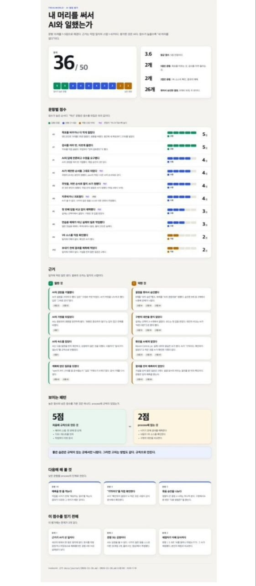

이틀(2026-11-16, 11-18) 동안 AI와 같이 한 작업을 놓고 질문 하나로 채점해 봤다. **"내 머리를 써서 AI와 일했는가."** 10개 문항을 1~5점으로 매겼고, 결과는 **36/50**이었다. 아래가 그 채점표 원본이다.

점수 자체보다 *어디서 높고 어디서 낮았는지* 가 흥미로웠다. 이 글은 그 모양을 정리하고, 같은 질문을 다룬 연구 두 편에 비춰 본 것이다.

## 문항과 점수

채점표에서 읽히는 문항과 점수를 그대로 옮긴다. 일부 문항은 **역산** 문항이다. "AI가 정한 순서를 그대로 따랐다"처럼 *그럴수록 내 머리를 덜 쓴* 문항은 거꾸로 채점했다.

| 점수 | 문항 |
| --- | --- |
| 5 | 목표를 바꾸거나 더 작게 잡았다 |
| 5 | 검사를 여러 번 돌렸다 |
| 4 | AI의 답에 반론하고 수정을 요구했다 |
| 4 | AI가 제안한 순서를 그대로 따랐다 (역산) |
| 4 | 무엇을, 어떤 순서로 할지 AI가 정했다 (역산) |
| 4 | 지적하거나 거부했다 |
| 3 | 첫 번째 답을 비교 없이 채택했다 (역산) |
| 3 | 연습용 예제가 아닌 실제의 일로 작업했다 |
| **2** | **1차 소스를 직접 확인했다** |
| **2** | **보내기 전에 결과를 예측해 적었다** |

평균 3.6점이다. 5점이 2개, 2점이 2개였다. 근거로 쓴 장면은 작업 일지에서 26개를 뽑았다.

## 보이는 패턴: 규칙이 있던 곳만 잘했다

5점과 2점을 나란히 놓으면 갈리는 기준이 하나 보인다.

- **5점 쪽은 처음부터 규칙으로 만들어 둔 것들이었다.** 한 번에 한 단계씩, 테스트를 먼저, 작업 끝나면 기록. 내가 그 순간 똑똑해서가 아니라, 하지 않으면 다음으로 못 넘어가게 돼 있었다.
- **2점 쪽은 process에 없는 것들이었다.** 시키기 전에 결과를 예측해 적기, 사람이 1차 소스를 직접 확인하기, 구현 대안을 비교하기. 이런 건 *해야지* 하는 의지에만 맡겨져 있었고, 결과는 2점이었다.

채점표의 결론 한 줄이 이렇다. **"좋은 습관은 규칙이 있는 곳에서만 나왔다. 그러면 고치는 방법도 같다. 규칙으로 만든다."**

그래서 다음 작업에 넣을 것은 세 가지다.

1. **예측을 한 줄 적는다.** 일을 시키기 전에 "결과가 이렇게 나올 것"을 한 줄 쓰고, 끝난 뒤 맞춰 본다.
2. **AI가 "확인했다"고 한 건 직접 확인한다.** 적어도 하나는 내 손으로 원문을 연다.
3. **묶음 승인을 나눈다.** 여러 개를 한 번에 "다 진행"으로 넘기지 않는다.

## 연구는 같은 방향을 가리킨다

### 확신이 클수록 덜 생각한다 — Microsoft Research, CHI 2025

Lee 외(Microsoft Research)는 지식노동자 **319명**에게 생성형 AI를 실제 업무에 쓴 사례 **936건**을 받아 분석했다 ([Lee et al., CHI 2025](https://www.microsoft.com/en-us/research/publication/the-impact-of-generative-ai-on-critical-thinking-self-reported-reductions-in-cognitive-effort-and-confidence-effects-from-a-survey-of-knowledge-workers/)). 핵심 결과는 두 줄이다.

- **AI에 대한 확신이 클수록 비판적 사고를 덜 했다.**
- **자기 능력에 대한 확신이 클수록 비판적 사고를 더 했다.** 대신 더 힘들다고 느꼈다.

논문은 생성형 AI가 비판적 사고의 *모양* 을 바꾼다고도 정리한다. 직접 문제를 푸는 일에서 **정보 검증, 응답 통합, 과업 관리(task stewardship)** 로 옮겨 간다는 것이다 ([논문 PDF](https://www.microsoft.com/en-us/research/wp-content/uploads/2025/01/lee_2025_ai_critical_thinking_survey.pdf)). 내 채점표에서 2점이 나온 두 문항(1차 소스 확인, 결과 예측)이 바로 그 *검증* 자리다. 일을 AI에 넘기면 할 일이 사라지는 게 아니라 검증 쪽으로 옮겨 가는데, 나는 그 옮겨 간 일을 process에 넣지 않았던 셈이다.

단, 이 연구는 **자기보고 설문이고 인과를 확정하지 않는다** — 저자들이 직접 밝힌 한계다. 참가자들이 "AI 쓰느라 덜 힘들었다"와 "비판적 사고를 덜 했다"를 섞어 답했을 수 있다는 점도 논문에 적혀 있다.

### 내가 쓴 글을 인용하지 못한다 — MIT Media Lab, 2025

Kosmyna 외(MIT Media Lab)는 에세이 쓰기 과제에서 참가자를 LLM 사용 / 검색엔진 사용 / 도구 없음의 세 그룹으로 나누고 뇌파(EEG)를 쟀다 ([arXiv:2506.08872](https://arxiv.org/abs/2506.08872)). 세션 1~3에 54명이 참가했고, 그룹을 맞바꾼 세션 4는 18명이 마쳤다.

- 뇌 연결성은 **도구 없음 > 검색엔진 > LLM** 순으로 약했다. 외부 도구에 기대는 만큼 줄었다.
- LLM 그룹은 에세이에 대한 **주인의식이 가장 낮았고**, 몇 분 전에 자기가 쓴 글을 **정확히 인용하는 데 어려움을 겪었다**.

이 결과는 **동료심사를 거치지 않은 프리프린트**다. 연구진도 프로젝트 페이지에서 결론을 예비적인 것으로 다뤄 달라고 적었고, 참가자 수가 적고 지역이 한정됐으며 에세이 과제 밖으로 일반화되지 않을 수 있다고 밝혔다 ([MIT Media Lab 프로젝트 페이지](https://www.media.mit.edu/projects/your-brain-on-chatgpt/overview/)). 그래서 "LLM을 쓰면 뇌가 나빠진다"로 읽으면 과장이다. 내가 가져가는 건 더 좁은 교훈이다. **스스로 만들지 않은 결과는 내 것으로 남지 않는다.** "보내기 전에 예측을 한 줄 적는다"는 그 결과를 조금이라도 내 것으로 만드는 가장 싼 방법이다.

## 이 점수를 믿기 전에

채점표 맨 아래에 스스로 붙인 한계가 세 개 있고, 그대로 옮긴다.

1. **근거가 AI가 쓴 일지다.** 채점의 재료인 작업 기록 상당 부분을 AI가 썼다. AI 기록에 남지 않은 장면은 점수에 안 잡혔다.
2. **문항 자체가 공정하지 않을 수 있다.** 어떤 문항은 작업 성격상 애초에 점수를 따기 어렵다.
3. **채점자가 이해당사자다.** 자기 평가다. 위 Microsoft 연구가 지적한 것처럼, 주관적 자기확신은 실제 역량과 어긋날 수 있다.

그러니 36이라는 숫자는 정밀한 측정값이 아니다. 쓸모는 **어디가 2점인지 알려 주는 지도** 라는 데 있다. 그리고 그 지도가 가리킨 처방은 "더 열심히 생각하자"가 아니었다. **생각해야 하는 지점을 규칙으로 만들어 process에 박아 두자** 였다. 5점이 나온 곳이 전부 그렇게 해 둔 곳이었으니까.

## References

1. Hao-Ping (Hank) Lee, Advait Sarkar, Lev Tankelevitch, Ian Drosos, Sean Rintel 외. *The Impact of Generative AI on Critical Thinking: Self-Reported Reductions in Cognitive Effort and Confidence Effects From a Survey of Knowledge Workers.* CHI 2025. [Microsoft Research](https://www.microsoft.com/en-us/research/publication/the-impact-of-generative-ai-on-critical-thinking-self-reported-reductions-in-cognitive-effort-and-confidence-effects-from-a-survey-of-knowledge-workers/) · [PDF](https://www.microsoft.com/en-us/research/wp-content/uploads/2025/01/lee_2025_ai_critical_thinking_survey.pdf)
2. Microsoft Research Blog. *The Future of AI in Knowledge Work: Tools for Thought at CHI 2025* (2025-04-18). [링크](https://www.microsoft.com/en-us/research/blog/the-future-of-ai-in-knowledge-work-tools-for-thought-at-chi-2025/)
3. Nataliya Kosmyna 외. *Your Brain on ChatGPT: Accumulation of Cognitive Debt when Using an AI Assistant for Essay Writing Task.* arXiv:2506.08872 (2025, 프리프린트·동료심사 전). [arXiv](https://arxiv.org/abs/2506.08872)
4. MIT Media Lab. *Your Brain on ChatGPT — Project Overview* (연구 한계 명시). [링크](https://www.media.mit.edu/projects/your-brain-on-chatgpt/overview/)
