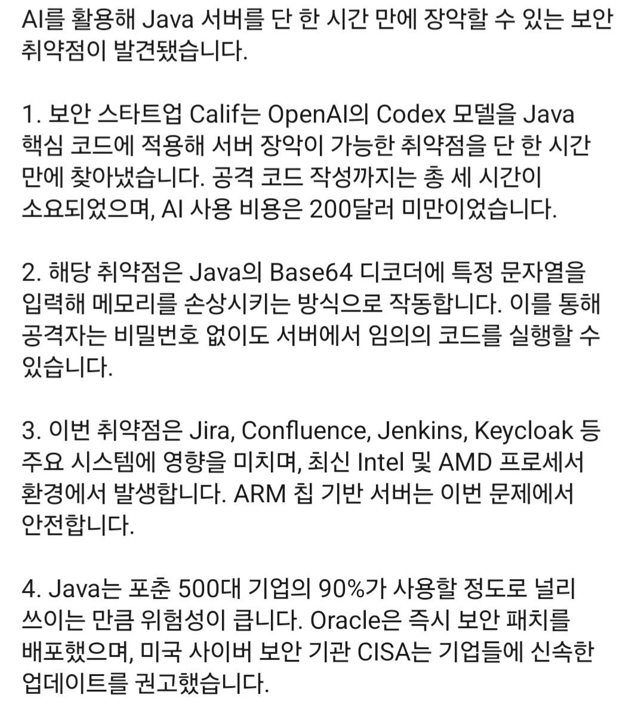

지난주 돌아다닌 뉴스 요약 한 장이다.

요약은 네 줄이다. ① 보안 스타트업 Calif 가 OpenAI Codex 로 한 시간 만에 찾았고, 공격 코드까지 세 시간, AI 비용은 200달러 미만이었다. ② Java 의 Base64 디코더에 특정 입력을 넣어 메모리를 손상시키고, 비밀번호 없이 임의 코드를 실행할 수 있다. ③ Jira·Confluence·Jenkins·Keycloak 등이 영향을 받고, 최신 Intel·AMD 에서 발생하며 ARM 은 안전하다. ④ Oracle 이 패치를 냈고 미국 CISA 가 업데이트를 권고했다.

큰 줄기는 맞다. 하지만 1차 출처를 읽으면 요약에서 빠진 **조건** 이 많고, 그 조건이 "우리 서버가 지금 급한가"를 가른다. 발견자 Calif 의 공지, OpenJDK 공식 권고, 각국 보안기관 경보를 기준으로 요약을 한 줄씩 다시 읽는다. 공격 기법의 세부는 다루지 않는다. 이 글의 관심은 *판단과 대응* 이다.

## 1. 사실관계 — 1차 출처 기준

| 항목 | 내용 | 출처 |
| --- | --- | --- |
| 이름·번호 | Java4Shell, **CVE-2026-114938** | [Calif 공지](https://calif.io/java4shell/) |
| 위치 | OpenJDK HotSpot 컴파일러의 x86-64 Base64 디코딩 고속 경로 | [OpenJDK 권고](https://openjdk.org/groups/vulnerability/advisories/2026-11-17) (`hotspot/compiler`) |
| 종류 | 힙 버퍼 오버플로 (CWE-122) | [캐나다 사이버보안센터 AL26-029](https://www.cyber.gc.ca/en/alerts-advisories/al26-029-critical-vulnerability-impacting-oracle-java-cve-2026-114938) |
| 심각도 | OpenJDK·Oracle: CVSS 3.1 **8.1 (High)** / Calif: CVSS 4.0 **9.2 (Critical)** | OpenJDK 권고 · Calif 공지 |
| 공개·패치 | 2026-11-17, 공개와 패치가 같은 날 | Calif 공지 · [CERT-EU 2026-021](https://cert.europa.eu/publications/security-advisories/2026-021) |
| 실제 악용 | 공개 시점 기준 보고 없음 | 캐나다 사이버보안센터 · [Beazley Security](https://labs.beazley.security/advisories/BSL-A1248) |

심각도가 두 개인 건 채점 체계가 달라서다. 같은 취약점을 발견자는 CVSS 4.0 으로 9.2, 패치를 낸 벤더는 CVSS 3.1 로 8.1 을 매겼다. 뉴스가 "치명적"이라 하든 "높음"이라 하든 둘 다 틀린 말은 아니다.

## 2. "메모리 안전한 Java" 에서 왜 메모리 손상이?

Java 코드는 배열 경계를 검사하니 메모리 손상과는 거리가 멀다고들 한다. 맞는 말이지만 그건 **Java 로 짠 코드** 얘기다. JVM 자체는 C++ 과 어셈블리로 되어 있고, 자주 쓰이는 표준 라이브러리 함수 일부는 JIT 컴파일러가 CPU 전용 명령으로 손수 짠 고속 구현(*인트린식*)으로 바꿔 실행한다.

이번 버그는 Base64 디코딩용 인트린식, 그중 **AVX-512 VBMI** 라는 x86 확장 명령을 쓰는 경로에 있었다 ([Calif](https://calif.io/java4shell/), [Datadog Security Labs](https://securitylabs.datadoghq.com/articles/java4shell-remote-code-execution-in-openjdk-cve-2026-114938/)). 잘못된 형식의 입력을 처리할 때 출력 길이 계산이 틀려 배열 밖을 덮어쓴다. Java 쪽 코드는 결국 그 입력을 거부하고 예외를 던지지만, 그 전에 이미 옆 메모리가 손상된 상태다.

"Java 는 메모리 안전하다"는 성질은 **Java 언어의 성질이지 JVM 구현의 성질이 아니다.** 성능을 위해 내려간 저수준 코드는 C 프로그램과 같은 종류의 버그를 가질 수 있다.

## 3. 요약 한 줄씩 다시 읽기

### ① "한 시간 만에 찾고, 세 시간에 공격 코드, 200달러 미만" — 발견자 본인의 주장

Calif 공지에 그대로 있는 숫자다. 연구원 Quang Luong 이 Codex 로 JIT·인트린식·암호 영역을 감사하게 해 한 시간 만에 찾았고, 첫 공격 코드까지 두 시간이 더 걸렸으며, 토큰 비용은 200달러 미만이었다고 한다 ([Calif](https://calif.io/java4shell/)). 다만 이건 **발견자 자기보고** 이고 제3자가 재현한 측정은 아니다.

같은 글에 요약이 안 옮긴 부분도 있다.

- Codex 가 처음 가져온 결과는 대부분 "slop" — 도달할 수 없거나 현실적이지 않은 것들이었고, 사람이 그걸 걸러 가며 계속 밀어붙였다.
- Calif 는 이걸 *AI 가 아니라 사람+AI 의 협업* ("centaur hacker") 이라 부른다.
- 그리고 **범용 공격 코드는 없다.** 애플리케이션마다 공격 경로를 따로 만들어야 한다.

사용된 모델은 Calif 가 밝히지 않았다. *뉴욕타임스 보도를 인용한* 2차 기사들이 OpenAI 의 비공개 보안 특화 모델(GPT-6 Cyber)이라고 전한다 ([BankInfoSecurity](https://www.bankinfosecurity.com/ai-agent-finds-critical-java-flaw-in-just-3-hours-a-33427), [BBC](https://www.bbc.com/news/articles/cke89jevqm1vo)). 1차 확인은 못 했다.

### ② "비밀번호 없이 임의 코드 실행" — 조건부다

가능은 하다. 하지만 각 기관의 문구는 조심스럽다. CERT-EU 는 "특정 상황에서" 인증 없는 원격 코드 실행이라고 썼고 ([CERT-EU](https://cert.europa.eu/publications/security-advisories/2026-021)), Datadog 은 **쉽게 일어나는 건 서비스 거부(JVM 크래시)이고, 안정적인 코드 실행은 대상별 추가 작업이 필요하다** 고 정리했다 ([Datadog](https://securitylabs.datadoghq.com/articles/java4shell-remote-code-execution-in-openjdk-cve-2026-114938/)).

요점은 공격자가 보낸 Base64 데이터가 **JDK 의 기본 디코더까지 그대로 닿아야** 한다는 것이다. CERT-EU 가 예로 든 경로는 HTTP Basic 인증, JWT, SAML 메시지, 쿠키, TLS 데이터다. Datadog 테스트에 따르면 `Base64.getDecoder()` · `getUrlDecoder()` 는 해당 경로를 타고, `getMimeDecoder()` 는 타지 않는다. 자체 디코더를 쓰거나 값을 먼저 검증·정규화하는 라이브러리는 다르게 동작할 수 있다.

### ③ "Jira·Jenkins·Keycloak… 최신 Intel·AMD, ARM 은 안전" — 반은 정확, 반은 부정확

제품 목록은 Calif 가 **기본 설정에서 코드 실행을 시연했다** 고 밝힌 것들이다. 인증 전 실행으로 Keycloak, Jira, Confluence, JFrog Artifactory, Jenkins, PingFederate, 인증 후 실행으로 Kafka 브로커, Solr, Elasticsearch, Gerrit, Spinnaker 를 들었고, 목록이 전부는 아니라고 했다 ([Calif](https://calif.io/java4shell/)).

부정확한 건 CPU 쪽이다. "최신 Intel·AMD" 가 아니라 **AVX-512 VBMI 를 지원하는 x86-64** 가 조건이다. CERT-EU 기준으로 `avx512f`, `avx512bw`, `avx512vbmi`, `bmi2` 네 가지가 모두 있어야 하고, 대표적으로 Intel Xeon Ice Lake 이후, AMD Zen 4 이후다. Datadog 도 "최신 시스템이라도 전부 지원하는 건 아니다" 라고 따로 짚었다. 반대로 요약의 "ARM 은 안전" 은 맞다. ARM64 JVM 은 해당 경로를 아예 실행하지 않는다.

여기에 Beazley 가 붙인 단서 하나가 중요하다. ARM 에서 안전한 건 **그 하드웨어** 이지 **그 빌드** 가 아니다. 같은 컨테이너 이미지를 x86-64 노드로 옮기면 다시 노출된다 ([Beazley](https://labs.beazley.security/advisories/BSL-A1248)).

### ④ "Oracle 패치, CISA 권고" — 맞다. 그리고 할 일이 더 있다

CISA 는 같은 날 즉시 패치를 촉구했다 ([CISA](https://www.cisa.gov/news-events/alerts/2026/11/17/critical-java-vulnerability-requires-immediate-patching)). 권고 내용 중 눈에 띄는 건 첫 항목이다. **JDK 가 소프트웨어 인벤토리에 따로 안 잡힐 수 있다** 는 것. 서드파티 제품에 번들되거나, 컨테이너 이미지·어플라이언스 안에 들어 있으면 "우리 회사엔 Java 가 없다"고 생각하기 쉽다.

## 4. 그래서 무엇을 확인하나

**영향 버전** (OpenJDK 권고 기준 — 17·21·25·27 계열이 영향, 8·11 은 이 CVE 대상 아님. 단 Oracle 8 성능 빌드 8u511-perf 는 예외로 포함)

| 계열 | 영향 | 첫 수정 릴리스 |
| --- | --- | --- |
| Java 17 | 17.0.6 ~ 17.0.21 | 17.0.21.1 |
| Java 21 | 21.0.13 이하 | 21.0.13.1 |
| Java 25 | 25.0.5 이하 | 25.0.5.1 |
| Java 27 | 27.0.1 이하 | 27.0.1.1 |

(출처: [CERT-EU](https://cert.europa.eu/publications/security-advisories/2026-021), [Datadog](https://securitylabs.datadoghq.com/articles/java4shell-remote-code-execution-in-openjdk-cve-2026-114938/). Temurin·Corretto·Zulu·Microsoft·Liberica·SapMachine·Red Hat 등 OpenJDK 기반 배포판도 영향이며 각자 일정대로 수정판을 낸다.)

**점검 순서**

1. **CPU 플래그** — Linux 에서 `lscpu | grep -o 'avx512vbmi'` 등으로 VBMI 지원 여부를 본다. 없으면 이 CVE 로는 공격받지 않는다. (그래도 패치는 한다.)
2. **JDK 버전** — 앱이 실제로 쓰는 런타임을 본다. OS 패키지가 아니라 컨테이너 이미지·번들 JRE 가 기준이다.
3. **패치 후 재시작** — 실행 중인 JVM 은 재시작 전까지 옛 코드를 계속 쓴다 ([Beazley](https://labs.beazley.security/advisories/BSL-A1248)).
4. **당장 못 올리면 임시 완화** — 해당 고속 경로를 끄는 JVM 옵션 `-XX:+UnlockDiagnosticVMOptions -XX:-UseBASE64Intrinsics` 또는 AVX-512 자체를 끄는 `-XX:UseAVX=2` ([CERT-EU](https://cert.europa.eu/publications/security-advisories/2026-021)). 후자는 성능이 떨어질 수 있고, **ARM JVM 에 넣으면 기동 자체가 실패** 하므로 x86 배포에만 건다 ([Datadog](https://securitylabs.datadoghq.com/articles/java4shell-remote-code-execution-in-openjdk-cve-2026-114938/)). 둘 다 완화일 뿐 수정이 아니다.
5. **외부 노출 우선** — 인터넷에 열린 서비스, 인증 앞단에서 Base64 를 디코딩하는 서비스부터.

## 5. 이 사건이 진짜로 말하는 것

취약점 하나보다 흥미로운 건 **발견 비용의 단위** 다. 성숙한 런타임의 깊은 곳에서 치명적 버그를 찾는 일은 원래 숙련자 몇 주짜리 일로 여겨졌다. 발견자 주장대로라면 이번엔 숙련자 한 명 + AI 로 몇 시간, 수백 달러였다. 이 숫자가 과장이 섞였더라도 방향은 분명하다.

다만 Calif 의 글 자체가 균형을 잡아 준다. AI 가 가져온 것 대부분은 쓰레기였고, 무엇이 진짜인지 고른 건 사람이었다. 그리고 공격 쪽만 빨라지는 게 아니다. 같은 도구로 방어 측도 감사를 돌릴 수 있다. 결국 바뀌는 건 **패치 주기에 대한 기대치** 다. 취약점 공개에서 악용까지의 간격이 줄어든다면, "다음 분기 정기 업데이트에 반영"이라는 운영 습관이 먼저 낡는다.

## References

1. Calif. *Java4Shell: Write once, RCE everywhere* (2026-11-17). [calif.io](https://calif.io/java4shell/) — 발견자 공지. 발견 시간·비용·시연 제품 목록은 발견자 자기보고.
2. OpenJDK Vulnerability Group. *OpenJDK Vulnerability Advisory: 2026/11/17*. [openjdk.org](https://openjdk.org/groups/vulnerability/advisories/2026-11-17)
3. CISA. *Critical Java Vulnerability Requires Immediate Patching* (2026-11-17). [cisa.gov](https://www.cisa.gov/news-events/alerts/2026/11/17/critical-java-vulnerability-requires-immediate-patching)
4. CERT-EU. *Security Advisory 2026-021: High Severity Vulnerability in Java SE and OpenJDK* (2026-11-18). [cert.europa.eu](https://cert.europa.eu/publications/security-advisories/2026-021)
5. Canadian Centre for Cyber Security. *AL26-029 — Critical vulnerability impacting Oracle Java* (2026-11-17). [cyber.gc.ca](https://www.cyber.gc.ca/en/alerts-advisories/al26-029-critical-vulnerability-impacting-oracle-java-cve-2026-114938)
6. Datadog Security Labs. *Java4Shell: Remote Code Execution in OpenJDK (CVE-2026-114938)* (2026-11-17). [securitylabs.datadoghq.com](https://securitylabs.datadoghq.com/articles/java4shell-remote-code-execution-in-openjdk-cve-2026-114938/)
7. Beazley Security Labs. *BSL-A1248: Java4Shell* (2026-11-17). [labs.beazley.security](https://labs.beazley.security/advisories/BSL-A1248)
8. Oracle. *Critical Security Patch Update — November 2026*. [oracle.com](https://www.oracle.com/security-alerts/cspunov2026.html)
9. 언론 보도(2차, 모델명 등 NYT 인용): [BleepingComputer](https://www.bleepingcomputer.com/news/security/critical-java4shell-flaw-allows-rce-attacks-on-major-java-applications/), [BankInfoSecurity](https://www.bankinfosecurity.com/ai-agent-finds-critical-java-flaw-in-just-3-hours-a-33427), [BBC](https://www.bbc.com/news/articles/cke89jevqm1vo)
